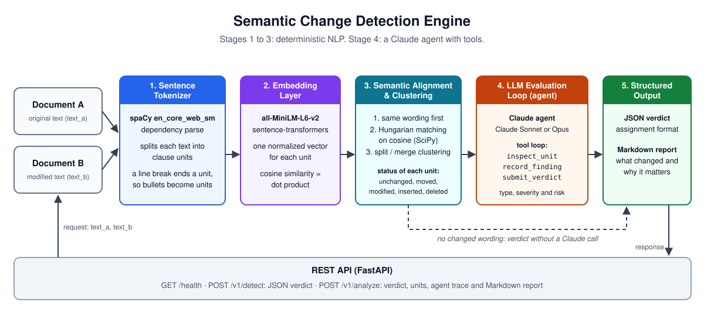

# Semantic Change Detection Engine

This REST API compares two versions of a text and finds the changes in meaning. It returns
a verdict in a fixed JSON format and a Markdown report for reviewers.

The engine is an agentic pipeline. Stages 1 to 3 use deterministic NLP to find the clauses
that changed. In stage 4, a Claude agent examines each changed clause with tools and
decides what the change means and why it matters.

## Architecture



| Stage | Module | Function |
|---|---|---|
| 1. Granular segmentation | `segmentation.py` | spaCy `en_core_web_sm` splits each text into sentences and clauses. A coordinated clause with its own subject becomes a new unit. A line break always ends a unit, so each bullet is a unit. |
| 2. Dense vector mapping | `embeddings.py` | `sentence-transformers/all-MiniLM-L6-v2` maps each unit to a normalized vector. The cosine similarity of two units is the dot product of their vectors. |
| 3. Bipartite alignment and clustering | `alignment.py` | Units with identical words match first. The Hungarian algorithm (SciPy `linear_sum_assignment`) pairs the other units by cosine similarity. A pair below the threshold (0.45) becomes a deletion and an insertion. An unmatched unit joins a neighbor pair when the join increases the similarity. This step finds split and merged sentences. |
| 4. LLM evaluation loop | `agent.py`, `prompts.py` | A Claude agent gets each unit with changed words. It examines the units with tools, records one finding for each unit, and submits the verdict for the document. |
| 5. Structured output | `models.py`, `report.py` | The API returns the verdict as JSON. It also renders a Markdown report with the risk of each change. |

Stage 3 gives each aligned unit one status:

| Status | Meaning | Sent to the agent |
|---|---|---|
| `unchanged` | Same words at the same position. Case and punctuation are ignored. | No |
| `moved` | Same words at a different position. | No |
| `modified` | The words changed. | Yes |
| `inserted` | The unit is only in text B. | Yes |
| `deleted` | The unit is only in text A. | Yes |

### Why the agent examines each changed unit

Embeddings show which units correspond. They do not show if the meaning changed. With
MiniLM, the pair with the reversed meaning has the higher similarity:

| Text A | Text B | Cosine | Meaning |
|---|---|---|---|
| Users may share their credentials. | Users may not share their credentials. | 0.88 | Reversed |
| Users must log in to continue. | Login is required to continue. | 0.82 | Same |

A similarity threshold cannot separate these cases. For this reason, the pipeline sends
each changed unit to the agent. The agent gets the similarity only as a hint.

### When the engine does not call Claude

If no unit changed its words, the engine gives the verdict without Claude:

- `no_change`: the texts are different only in case, spacing or punctuation.
- `paraphrase`: the same sentences occur in a different order.

## The evaluation agent

The agent runs a tool loop on the Claude Messages API. Claude decides which tools to call
and when to stop. The code validates each tool input.

| Tool | Function |
|---|---|
| `inspect_unit` | Returns the word edits of one unit and the text before and after it. |
| `record_finding` | Records the verdict for one changed unit: change type, severity, confidence, summary, evidence and risk. |
| `submit_verdict` | Records the verdict for the document and ends the loop. |

Loop rules:

- If a tool input is not valid, Claude gets an error result. Claude can then correct the call.
- `submit_verdict` fails until each changed unit has a finding.
- If Claude replies with text only, the loop tells Claude to use the tools.
- If Claude refuses or the reply is cut off, the loop stops before it runs a tool. The API
  returns 502.
- If Claude gives no verdict in `SCD_AGENT_MAX_TURNS` turns, the API returns 502.

Request settings:

| Setting | Value |
|---|---|
| Model | `claude-opus-5-5`, or the value of `SCD_LLM_MODEL` |
| Thinking | Adaptive |
| Effort | `medium` |
| Tool schemas | `strict: true`. The tool inputs always match the schemas. |
| Prompt caching | On. Later turns read the tools, the system prompt and the earlier turns from the cache. |
| Conversation | Append-only. Each assistant turn goes back to the API unchanged. |

The prompt marks the document texts as data. The engine escapes `</` in the texts, so a
text cannot close a prompt tag.

## Change types

| `change_type` | `change_detected` | Meaning |
|---|---|---|
| `no_change` | `false` | Identical apart from case, spacing or punctuation. |
| `paraphrase` | `false` | Different words, same meaning. |
| `meaning_reversed` | `true` | The statement now says the opposite. |
| `restriction_added` | `true` | A new limit: time window, condition, cap, fee or narrower scope. |
| `restriction_removed` | `true` | The text removes or loosens a limit. |
| `obligation_strengthened` | `true` | A duty becomes stronger or new. |
| `obligation_weakened` | `true` | A duty becomes weaker or applies in fewer cases. |
| `numeric_change` | `true` | An amount, percentage, count, duration, rate or date changes. |
| `entity_change` | `true` | The text replaces a party, product or place. |
| `content_change` | `true` | The meaning changes in a different way. |
| `information_added` | `true` | New detail without an effect on a restriction or a duty. |
| `information_removed` | `true` | The text removes a detail or a clause. |

Severity:

| `severity` | Rule |
|---|---|
| `high` | The change affects rights, duties, permissions, money or deadlines, or reverses the meaning. |
| `medium` | The change affects facts, parties, scope or details with moderate impact. |
| `low` | The change has no effect or a minor effect on the meaning. |

## Setup and run

### Requirements

- Python 3.11 or later. To see the version, run `python3 --version` (on Windows,
  `py --version`). For a newer version, go to <https://www.python.org/downloads/>.
- An internet connection for the first installation and the first start. pip downloads
  the packages (PyTorch included, about 1 GB on disk). The first start downloads the
  MiniLM model (about 90 MB) from Hugging Face.
- A Claude API key, for each request where words changed. Create the key in the Claude
  Console at <https://platform.claude.com>.

### Step 1: Get the project

- **From the zip file:** unzip `semantic-change-engine.zip`, then open a terminal in the
  folder `semantic-change-engine`. The zip already has the `.env` file with the settings.
- **From GitHub:** clone the repository and open a terminal in its folder. Then copy the
  example settings file and put your API key in it:

  ```bash
  cp .env.example .env
  ```

Caution: `.env` holds your API key. Do not commit it, and do not send it to other persons.

### Step 2: Install

Caution: create `.venv` on each computer. A `.venv` folder copied from a different
computer does not work.

macOS and Linux:

```bash
python3 -m venv .venv
.venv/bin/python -m pip install --upgrade pip
.venv/bin/python -m pip install -e ".[dev]"
```

Windows (PowerShell):

```powershell
py -m venv .venv
.venv\Scripts\python -m pip install --upgrade pip
.venv\Scripts\python -m pip install -e ".[dev]"
```

pip also installs the spaCy English model from its wheel URL.

### Step 3: Check the settings

Open `.env` and make sure that it has these lines:

```bash
ANTHROPIC_API_KEY=sk-ant-...
SCD_LLM_MODEL=claude-sonnet-5-5
```

`SCD_LLM_MODEL` is optional. Without it, the engine uses `claude-opus-5-5`. The section
[Configuration](#configuration) lists all settings.

### Step 4: Run the tests (optional)

The tests need no API key and make no Claude calls.

```bash
.venv/bin/pytest
```

On Windows, run `.venv\Scripts\pytest`. The result must be `32 passed`.

### Step 5: Start the server

macOS and Linux:

```bash
.venv/bin/uvicorn semantic_change.api:create_app --factory --port 8000 --env-file .env
```

Windows (PowerShell):

```powershell
.venv\Scripts\uvicorn semantic_change.api:create_app --factory --port 8000 --env-file .env
```

At startup, the server loads the spaCy and MiniLM models. When the terminal shows
`Application startup complete`, the server is ready. To stop the server, press `Ctrl+C`.

### Step 6: Send requests

- **Browser:** open <http://127.0.0.1:8000/docs>, select an endpoint, select
  **Try it out**, and then select **Execute**.
- **curl:** use the commands in [Endpoints](#endpoints). Open a second terminal, because
  the server uses the first one. On Windows, use the browser or Postman instead.
- **Postman:** import the collection, as [Postman](#postman) describes.

### Troubleshooting

| Problem | Solution |
|---|---|
| `python3: command not found`, or Python is older than 3.11 | Install Python from <https://www.python.org/downloads/>. |
| `address already in use` | A different program uses port 8000. Start the server with `--port 8001`, and use port 8001 in the requests. |
| `503` and `No Claude credentials` | The server did not get the key. Start it with `--env-file .env`, and make sure that `.env` has `ANTHROPIC_API_KEY`. |
| `503` and `Claude rejected ANTHROPIC_API_KEY` | The key is wrong or deleted. Create a new key in the Claude Console and put it in `.env`. |
| `502` | The Claude API returned an error. The `detail` field gives the cause. For example, the credit is used up. |
| The first start is slow | The first start downloads the MiniLM model. Later starts use the downloaded copy. |

## Endpoints

| Method | Path | Response |
|---|---|---|
| `GET` | `/health` | Status, version and model names. |
| `POST` | `/v1/detect` | The verdict in the assignment format. |
| `POST` | `/v1/analyze` | The verdict, the changed units with their findings, pipeline data, the agent trace and the Markdown report. |

Both `POST` endpoints take the same body:

```json
{
  "text_a": "Users can cancel their subscription anytime.",
  "text_b": "Users can cancel their subscription within 7 days."
}
```

### Example: restriction added

```bash
curl -s -X POST http://127.0.0.1:8000/v1/detect \
  -H "Content-Type: application/json" \
  -d '{"text_a": "Users can cancel their subscription anytime.",
       "text_b": "Users can cancel their subscription within 7 days."}'
```

Response from a real run with `claude-sonnet-5-5`. Claude writes the summary, so the words
can be different in each run:

```json
{
  "change_detected": true,
  "change_type": "restriction_added",
  "summary": "Cancellation changed from anytime to a 7-day window, which narrows users' rights.",
  "severity": "high",
  "confidence": 0.95,
  "evidence": ["anytime → within 7 days"]
}
```

### Example: paraphrase

```bash
curl -s -X POST http://127.0.0.1:8000/v1/detect \
  -H "Content-Type: application/json" \
  -d '{"text_a": "Users must log in to continue.",
       "text_b": "Login is required to continue."}'
```

Response from a real run with `claude-sonnet-5-5`:

```json
{
  "change_detected": false,
  "change_type": "paraphrase",
  "summary": "The sentence was reworded, but the meaning is the same. Login is still required to continue.",
  "severity": "low",
  "confidence": 0.95,
  "evidence": []
}
```

### Full analysis

```bash
curl -s -X POST http://127.0.0.1:8000/v1/analyze \
  -H "Content-Type: application/json" \
  -d '{"text_a": "Refunds are available within 30 days of purchase. Shipping is free for all orders.",
       "text_b": "Shipping is free for all orders. Refunds are available within 14 days of purchase. A processing fee of $5 applies to all refunds."}' \
  | python3 -m json.tool --no-ensure-ascii
```

`/v1/analyze` returns these fields:

| Field | Content |
|---|---|
| `result` | The verdict, the same as `/v1/detect`. |
| `units` | Each unit that is not `unchanged`: status, similarity, original text, modified text, and the finding of the agent with its `risk`. |
| `pipeline` | The number of units in each text and the number of units sent to the agent. |
| `agent` | The model, the turns, the tool calls and the token counts. `turns` is 0 when the engine did not call Claude. |
| `report` | The Markdown report. |

The Markdown report has these sections:

1. A verdict table, the summary and the evidence.
2. One entry for each change: "What changed", "Why it matters" and "Evidence".
3. The units with new words and the same meaning.
4. The moved units.

### Postman

The file `postman/semantic-change-engine.postman_collection.json` has 7 requests. Each
request has tests.

1. In Postman, select **Import** and then select the collection file.
2. Start the server on port 8000. For a different host or port, change the collection
   variable `baseUrl`.
3. Send one request, or run all the requests with **Run collection**.

| Request | Calls Claude |
|---|---|
| Health | No |
| Detect - example 1: restriction added | Yes |
| Detect - example 2: paraphrase | Yes |
| Detect - meaning reversed | Yes |
| Analyze - policy with several changes | Yes |
| Detect - no change (no Claude call) | No |
| Detect - invalid request (422) | No |

Postman can also import the OpenAPI schema from <http://127.0.0.1:8000/openapi.json>.

### Errors

| Status | Cause |
|---|---|
| `422` | The body is not valid, or a text has more than `SCD_MAX_TEXT_CHARS` characters. |
| `502` | The agent failed. For example, Claude refused, the reply was cut off, or the Claude API returned an error. |
| `503` | No Claude credentials are available. Set `ANTHROPIC_API_KEY`. |

Without credentials, requests with no changed words still succeed, because they do not
need Claude.

## Configuration

The engine reads these environment variables:

| Variable | Default | Function |
|---|---|---|
| `ANTHROPIC_API_KEY` | none | The Claude API key. `ANTHROPIC_AUTH_TOKEN` or an `ant auth login` profile also work. |
| `SCD_SPACY_MODEL` | `en_core_web_sm` | The spaCy pipeline for stage 1. |
| `SCD_EMBEDDING_MODEL` | `sentence-transformers/all-MiniLM-L6-v2` | The embedding model for stage 2. |
| `SCD_ALIGN_THRESHOLD` | `0.45` | The minimum cosine similarity to pair two units. |
| `SCD_LLM_MODEL` | `claude-opus-5-5` | The Claude model of the agent. |
| `SCD_LLM_EFFORT` | `medium` | `low`, `medium`, `high`, `xhigh` or `max`. |
| `SCD_LLM_MAX_TOKENS` | `16000` | The output token limit for each agent turn. |
| `SCD_AGENT_MAX_TURNS` | `10` | The maximum number of agent turns for each request. |
| `SCD_MAX_TEXT_CHARS` | `20000` | The maximum length of each text. |

## Tests

```bash
.venv/bin/pytest
```

| File | Scope |
|---|---|
| `tests/test_stages.py` | Stages 1 to 3 with the real spaCy and MiniLM models. |
| `tests/test_agent.py` | The agent loop with a scripted Claude client. |
| `tests/test_api.py` | The REST API from end to end: real stages 1 to 3 and a scripted Claude client. |

The tests make no calls to the Claude API, so they need no API key.

Static checks:

```bash
.venv/bin/ruff check . && .venv/bin/ruff format --check . && .venv/bin/mypy
```

## Project layout

```text
.env.example         Settings template (copy it to .env)
pyproject.toml       Package metadata and dependencies
docs/
└── architecture.svg  The architecture image of this README
postman/
└── semantic-change-engine.postman_collection.json  Requests and tests for Postman
tests/               Tests of the stages, the agent loop and the REST API
src/semantic_change/
├── api.py           REST API (FastAPI)
├── pipeline.py      Runs the stages in sequence
├── segmentation.py  Stage 1: clause segmentation (spaCy)
├── embeddings.py    Stage 2: sentence vectors (sentence-transformers)
├── alignment.py     Stage 3: Hungarian alignment and clustering
├── agent.py         Stage 4: Claude evaluation agent and its tools
├── prompts.py       System prompt and task message of the agent
├── report.py        Stage 5: Markdown report
├── models.py        Request and response schemas
├── taxonomy.py      Change types and severities
└── config.py        Settings from SCD_* environment variables
```
